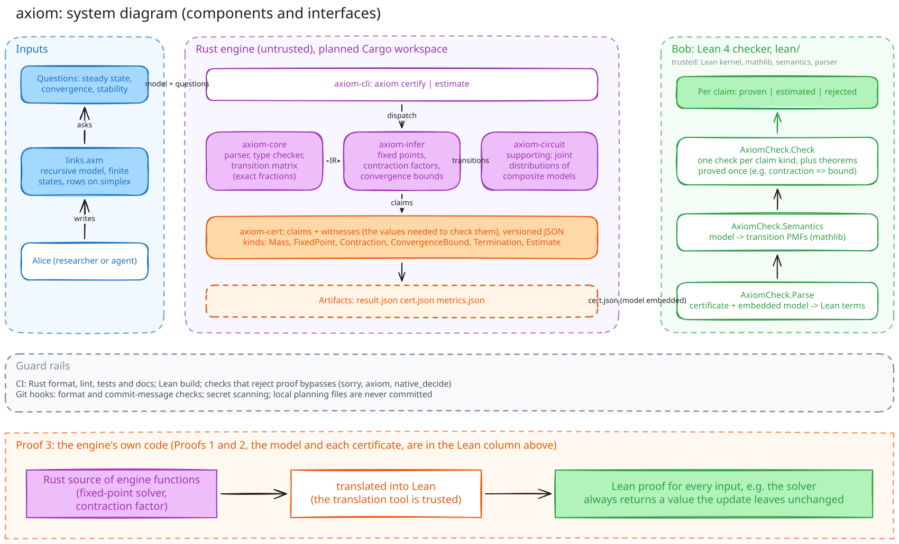
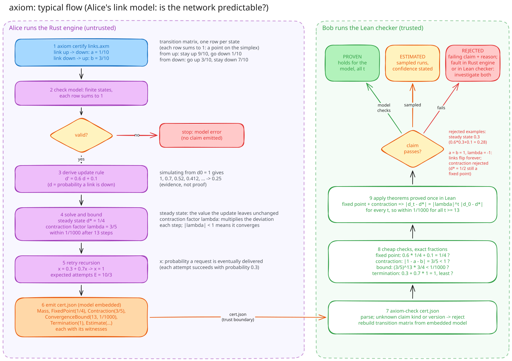
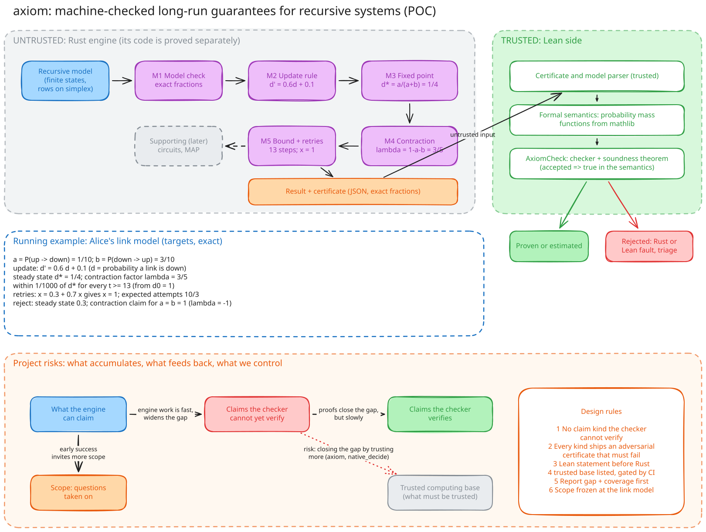

# axiom

Machine-checked long-run guarantees for recursive probabilistic systems: a proof of concept in Rust and Lean 4.

> **Status: proof of concept.** This repository currently contains workspace configuration only. No part of the analysis program, its output format or its checker has been implemented. Everything below describes the planned design, and nothing here should be relied upon for any purpose other than the research it describes.

## Research question

A *probabilistic system* is one whose next *state*, its condition at a given step, is chosen at random. In Alice's network, described below, the state of a link is up or down, and an up link fails at the next step with probability $0.1$. Some such systems feed their own state back into themselves: the next state is a random function of the current one. This project asks whether an analysis program that nobody needs to trust can determine where such a system goes in the long run, how quickly it gets there and whether it recovers from a disturbance. It also asks whether that program can supply evidence which a separate and much cheaper checker can verify, and how far the program itself can be proved correct.

Systems of this kind include retry loops, failure and repair processes, and any program whose next state depends randomly on its current one. Running such a system for many steps and observing that it settles is common practice, but observation covers only the starting states and parameter values that were tried. A *black box*, a system whose code or equations are unavailable and which can only be run and observed, may behave differently in a region nobody sampled.

The project therefore distinguishes three outcomes for each *claim*, a single statement about the system's behaviour. A claim is *proven* when it follows by a machine-checked proof from an explicit *model* of the system, a precise mathematical description such as the failure and repair probabilities of a link. A claim is *estimated* when it rests on sampled runs; it is then reported with a stated *error probability*, the chance that the estimate lies outside its stated tolerance (for example $0.001$), and never presented as a proof. A claim that the checker refuses is *rejected*.

## Alice and Bob

Two roles are used throughout this repository. Alice operates a distributed network and needs to know how it behaves over time: what fraction of links will be down in the long run, how many steps the network takes to settle after a failure, and whether a burst of failures dies out. She describes the network as a small probabilistic model and runs the analysis program, called the *engine*, on it. The engine is to compute the long-run value, how fast the system approaches it and a step count after which it is close; all three are defined in the next section. The engine is ordinary software, to be written in the programming language Rust, and may contain errors.

Bob must decide whether to rely on Alice's claims. He may be an auditor or an operator who did not write the engine. Bob neither reruns the engine nor reads its source. He receives Alice's model, her claims and a *certificate*, a file that records each claim together with the specific numbers needed to verify it, and he runs the *checker*. The checker is to be written in Lean, a programming language and *proof assistant* (software that checks mathematical proofs step by step) whose small core, the *kernel*, accepts a proof only if every step is valid. If the checker accepts a proven claim, the claim will hold for the model at every step, including steps nobody simulated. An accepted estimated claim holds only up to its stated error probability. If the checker rejects a claim, Bob is told which one failed and why.

The arrangement is useful only if Bob's work is much smaller than Alice's, only if a false proven claim cannot pass Bob's check, and only if a false estimated claim passes with at most its stated error probability. Bob's acceptance concerns the model; whether the model describes Alice's real network remains Alice's responsibility.

## The running example

Each link in Alice's network is either up or down at every step. An up link fails with probability $a = 0.1$, and a down link is repaired with probability $b = 0.3$. These probabilities form a *transition matrix*: one row per current state (up or down), giving the probability of each next state. The row for an up link is $(0.9, 0.1)$ and the row for a down link is $(0.3, 0.7)$:

$$P = \begin{pmatrix} 1-a & a \\ b & 1-b \end{pmatrix} = \begin{pmatrix} 0.9 & 0.1 \\ 0.3 & 0.7 \end{pmatrix}$$

Each row consists of non-negative numbers summing to one, because a link must be in exactly one state at the next step. The set of all such rows is called the *unit simplex*; for two states it is the set of pairs $(p, 1-p)$ with $0 \le p \le 1$, so $(0.9, 0.1)$ lies on it and $(0.9, 0.2)$ does not. The model's parameters therefore live on the unit simplex, and a parametric claim, one stated for all admissible parameters, has to hold for every row drawn from it.

Let $d_t$ denote the probability that a link is down at step $t$. Then

$$d_{t+1} = (1-b)\,d_t + a\,(1-d_t) = 0.6\,d_t + 0.1.$$

Starting with every link down ($d_0 = 1$), the sequence runs $1, 0.7, 0.52, 0.412, \dots$, approaching $0.25$. Four terms describe this behaviour. A *steady state*, or *fixed point*, written $d^\ast$, is a value that the update leaves unchanged; here $d^\ast = 0.25$, since $0.6 \times 0.25 + 0.1 = 0.25$. The *contraction factor*, written $\lambda$, is the number that multiplies the *deviation* $d_t - d^\ast$, the signed distance from the steady state, at each step. Here $\lambda = 0.6$, so the initial deviation $d_0 - d^\ast = 0.75$ becomes $0.45$ after one step:

$$d_{t+1} - d^\ast = \lambda\,(d_t - d^\ast).$$

Its absolute value $\lvert\lambda\rvert$ is the factor by which the distance to the steady state shrinks; a negative $\lambda$ means the value overshoots the steady state from alternating sides. When $\lvert\lambda\rvert < 1$ the distance falls by the same factor at every step and tends to zero, which is what *convergence* means here. *Stability* means that a small disturbance away from the steady state dies out instead of growing; if a burst of failures moves $d_t$ from $0.25$ to $0.26$, the deviation of $0.01$ falls to $0.006$ after one step.

The engine is expected to produce, and the checker to verify, the following claims.

| Claim kind | Statement | Value in the example |
| --- | --- | --- |
| Mass | each row of the transition matrix sums to one | $(0.9, 0.1)$ and $(0.3, 0.7)$ |
| FixedPoint | $d^\ast = 0.6\,d^\ast + 0.1$ | $d^\ast = \frac{a}{a+b} = \frac{1}{4}$ |
| Contraction | the deviation is multiplied by $\lambda$ at each step, with $\lvert\lambda\rvert < 1$ | $\lambda = 1 - a - b = \frac{3}{5}$ |
| ConvergenceBound | $\lvert d_t - d^\ast\rvert = \lvert\lambda\rvert^t\,\lvert d_0 - d^\ast\rvert$ for every $t$ | from $d_0 = 1$, within $10^{-3}$ of $d^\ast$ for every $t \ge 13$ |
| Stability | a disturbance of the steady state shrinks by $\lvert\lambda\rvert$ per step | a disturbance of $10^{-2}$ falls below $10^{-4}$ within 10 steps |
| Parametric stability | the claims hold for every *admissible* choice of $a$ and $b$, that is, every pair for which $\lvert\lambda\rvert < 1$; a parametric claim covers a range of parameter values instead of one | for all $a, b \in [0,1]$ with $0 < a + b < 2$, $d^\ast = \frac{a}{a+b}$ and $\lvert\lambda\rvert < 1$ |

Retries add *recursion*, a quantity defined in terms of itself, with no fixed upper limit on the number of steps. Suppose each attempt to deliver a request succeeds with probability $0.3$, independently of earlier attempts. The probability $x$ of eventual delivery satisfies

$$x = 0.3 + 0.7\,x,$$

because either the first attempt succeeds or it fails and the situation repeats. The least non-negative solution of this equation is $x = 1$. The word *least* matters because a recursive equation may in general have several solutions, and the probability of eventual delivery, which the claim kind Termination records, is the smallest one in $[0,1]$. The *expected number* of attempts $E$, the average over many requests, is likewise the least solution of $E = 1 + 0.7\,E$, which gives $E = \frac{10}{3}$ and excludes $E = \infty$. The probability that a request is still undelivered after 20 attempts is $0.7^{20} \approx 0.0008$. The *support*, the set of outcomes with non-zero probability, is infinite (one, two, three or more attempts), yet each of these quantities is exact and checkable.

Two negative tests are planned. In the first, the engine claims a steady state of 0.3, and the checker must reject it because $0.6 \times 0.3 + 0.1 = 0.28$. In the second, $a = b = 1$, so every link changes state at each step, $d_{t+1} = 1 - d_t$ and $\lambda = -1$. An engine that samples only even-numbered steps observes an apparently constant system ($d_{2k} = d_0$) and may claim convergence. The checker must reject the Contraction and ConvergenceBound claims because $\lvert\lambda\rvert = 1$. A FixedPoint claim of $d^\ast = \frac{1}{2}$ would still be accepted, since that value is unchanged by the update even though the system never approaches it.

When Alice can supply only a black box, the engine can still estimate quantities from sampled runs. For *independent, identically distributed* runs (each run uses the same black box and its outcome does not influence any other run) whose outcomes lie between 0 and 1, Hoeffding's inequality, a standard result that bounds how far the average of such samples can stray from its expected value, requires

$$n \ge \frac{\ln(2/\delta)}{2\varepsilon^2}$$

runs to estimate a probability to within $\varepsilon$ with error probability at most $\delta$. For $\varepsilon = 0.01$ and $\delta = 0.001$ this gives $\ln(2000)/0.0002 \approx 38{,}004.5$, rounded up to $n = 38{,}005$. The certificate records such a result under the claim kind Estimate and labels it estimated. The checker verifies only the arithmetic of the bound; the behaviour of the black box remains unchecked.

## What Lean proves

Lean is to be used for three proofs, each of which removes a different source of doubt.

The first concerns the model. Lean is to define what the link model means mathematically and to prove facts about it, for example that $d^\ast = \frac{1}{4}$ and that, starting from $d_0 = 1$,

$$\left\lvert d_t - \tfrac{1}{4}\right\rvert = \left(\tfrac{3}{5}\right)^t \cdot \tfrac{3}{4} \quad \text{for every step } t.$$

This would establish that the model of the system settles and recovers from disturbances. It would not establish that the real network behaves like the model.

The second concerns each certificate. The engine proposes values such as $d^\ast = \frac{1}{4}$, $\lambda = \frac{3}{5}$ and a step count of 13. The checker is to confirm each value exactly and then apply a general theorem, proved once, which states that a fixed point together with $\lvert\lambda\rvert < 1$ implies the bound for every step. An accepted certificate therefore becomes a Lean theorem about the model. A *soundness theorem* about the checker is to state that it accepts only true claims, so a fault in the engine can lead to a rejected certificate but never to an accepted false claim.

The third concerns the engine itself. Its Rust source is to be translated into Lean by a tool that rewrites each Rust function as a Lean definition, and Lean is to prove that the translated functions are correct for every input, for example that the fixed-point solver always returns a value the update leaves unchanged. This stronger guarantee would mean that the engine never produces a wrong certificate in the first place, but it costs considerably more effort than checking outputs. The proof of concept therefore begins with the first two proofs and applies the third to the engine's core functions, starting with the fixed-point solver and the contraction factor, extending it as far as the effort allows.

A rejection is a signal that something in the pipeline is wrong, and the checker reports which claim failed and why so that the cause can be found. There are four possible causes. The engine may contain a fault, for example an arithmetic error in the fixed-point solver. The claim may be false for the model, as in the negative tests, which is also an engine fault because the engine should not have made it. The certificate may not match what the checker expects, for example because the engine and checker use different versions of the certificate format. Finally, the Lean side may contain a fault. The formal semantics (the mathematical meaning Lean assigns to each model, defined under Approach) may describe the language differently from the engine. The parser, the code that reads the certificate file, may misread a valid certificate. The checker may also be too weak to verify a true claim. The soundness theorem rules out the opposite error, a false claim being accepted, but it does not rule out a true claim being rejected. Every rejection of a claim the engine believes to be true is therefore investigated on both sides, and proofs about the engine's code (the third proof) narrow the search by excluding faults in the functions they cover.

## Approach

The design divides the system by trust. The engine, written in Rust, is to accept a model written in a small probabilistic language with typed variables, finite state spaces and recursion. It is to compute the transition matrix with exact fractions instead of floating-point numbers, which store most decimals approximately (the binary floating-point value of $0.1$ is slightly above $\frac{1}{10}$). It then solves the fixed-point equations of finite-state recursions, derives contraction factors and convergence bounds, and emits a certificate. The certificate lists each claim together with its *witnesses*, the concrete values the checker needs, such as the proposed fixed point, the contraction factor and the step count. The model itself is embedded in the certificate, so the checker rebuilds the transition matrix from the model and ignores any transition values the engine supplies. The engine is planned as a Cargo workspace, a set of Rust packages called crates that are built together: `axiom-core`, `axiom-infer`, `axiom-circuit`, `axiom-cert` and `axiom-cli`.

A separate Lean 4 project (`lean/`, library `AxiomCheck`) is to define the *semantics* of the language: the probability distribution that each model denotes. It expresses these distributions as *probability mass functions*, which assign a probability to each outcome of a discrete distribution, using mathlib, the community library of formalised mathematics for Lean; in the steady state, a link's mass function assigns $\frac{3}{4}$ to up and $\frac{1}{4}$ to down. The checker processes each certificate through the modules `AxiomCheck.Parse`, `AxiomCheck.Semantics` and `AxiomCheck.Check`. Checking a fixed point requires one substitution, and checking a contraction requires one inequality. The theorem that turns these two facts into a bound for every step is to be proved once in Lean and reused. The soundness theorem will state that every claim the checker accepts as proven holds under the formal semantics.

The *trusted computing base* is the set of components whose errors could cause a false claim to be accepted. It comprises the Lean kernel, the parts of mathlib used by the semantics, the formal semantics itself and the certificate and model parser. If the checker runs as compiled machine code, it also includes the Lean compiler and runtime; evaluating the checker step by step inside the kernel is slower but trusts nothing beyond the kernel. The checker leaves the trusted computing base only once its soundness theorem is proved. The engine is outside it from the start, because every claim it makes is checked. Proofs about the engine's own code add a further trusted component, the tool that translates Rust into Lean, since a fault in the translation could make the Lean model of the code differ from the code that runs.

Finite-state recursions, those whose variables take finitely many values, reduce to systems of linear fixed-point equations, such as $x = 0.3 + 0.7\,x$, and can be solved exactly. Arbitrary recursive probabilistic programs cannot, because their *termination*, whether they eventually stop, is *undecidable* in general: no algorithm answers the question correctly for every program. The language is therefore restricted to structures whose fixed points the engine can compute and the checker can verify. The design keeps further machinery for models built from several components, for example to compute their transition probabilities. It computes the combined distribution of several variables exactly (for two links, the probability of each of the four up/down combinations). It splits that distribution into smaller *factors*, tables that each involve only some of the variables, and compiles it into *sum-product circuits*, networks of weighted sums and products that answer queries quickly.

### System

Components on each side of the trust boundary, and the certificate file that connects them.

### Typical flow

One planned analysis of the link model. Alice will run the command-line tool `axiom certify links.axm` on her model file; the engine is to check the model, solves for the steady state, derives the contraction factor and convergence bound, and write the certificate `cert.json` in JSON, a structured text format. Bob will run `axiom-check cert.json`; the checker is to rebuild the transition matrix from the embedded model, checks each claim and labels it proven, estimated or rejected.

### Overview

The engine stages, the running example and a map of the project's main risks, which the design treats as the growth of unchecked claims and of the trusted computing base. Editable sources for all diagrams are in `docs/*.excalidraw`.

## Scope of the proof of concept

The proof of concept covers finite-state models, recursion whose fixed-point equations are finite and linear, and the claim kinds Mass, FixedPoint, Contraction, ConvergenceBound, Termination and Estimate. Arbitrary Rust programs, unbounded state spaces and general continuous dynamics are excluded. The project may later extend to nonlinear dynamics, for which local stability would be certified through the *Jacobian* (the matrix of first derivatives of the update) at a fixed point. For the linear link update the Jacobian is the single number $0.6 = \lambda$. It may also extend to *maximum a posteriori* queries (finding the single most probable outcome) on sum-product circuits, and to models whose outcomes mix types, such as numbers and labels.

## Evaluation

Results will be reported for correctness, verification coverage (the proportion of emitted claim kinds that the checker can verify), implementation coverage (the proportion of engine functions with a Lean proof of correctness), certificate size, analysis time and checking cost. The central comparison is between the cost of checking a certificate and the cost of reaching the same conclusion by simulation. For a convergence bound, simulation cost grows with the number of steps and starting states covered. Checking cost is independent of the number of starting states and grows only with the *bit length* of the step count and of the fractions involved, the number of binary digits needed to write them (13 needs four). Coverage and the rejection of invalid claims take precedence over performance figures.

## Limitations

A proven claim establishes that a claim follows from the formal semantics of the supplied model. It does not establish that a real system behaves like that model. An estimated claim inherits the assumptions of its sampling procedure, notably independence between runs. The guarantees also depend on the faithfulness of the formal semantics and of the parser, both of which are trusted.

## Contributing

Instructions for building, testing and running the project, and the rules for commits and pull requests, are in [CONTRIBUTING.md](CONTRIBUTING.md).
